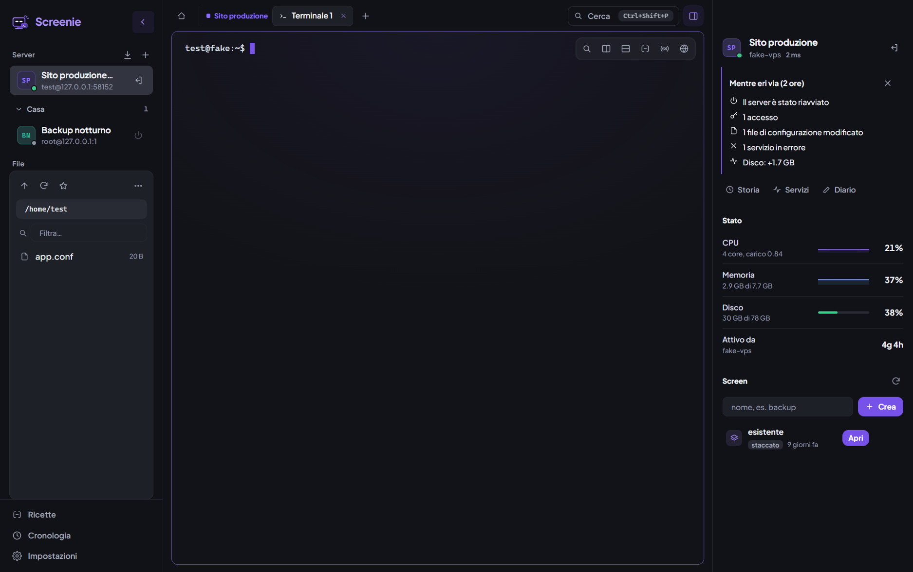
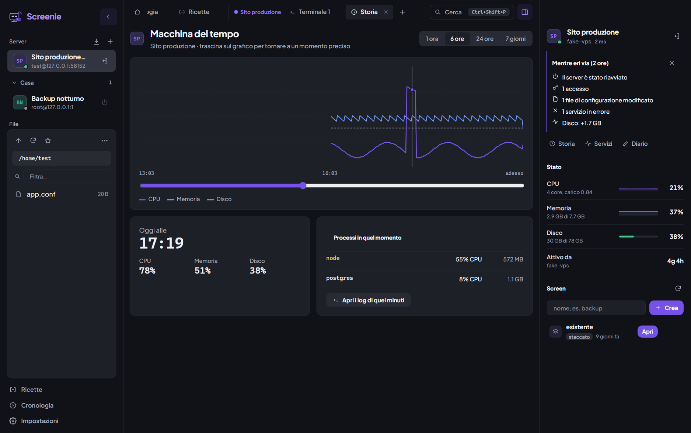
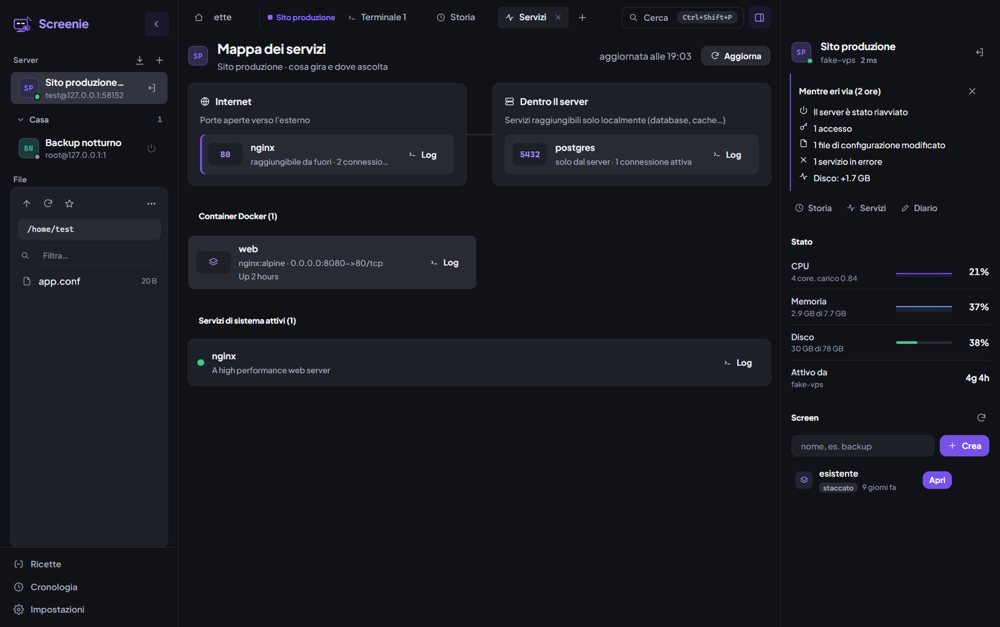
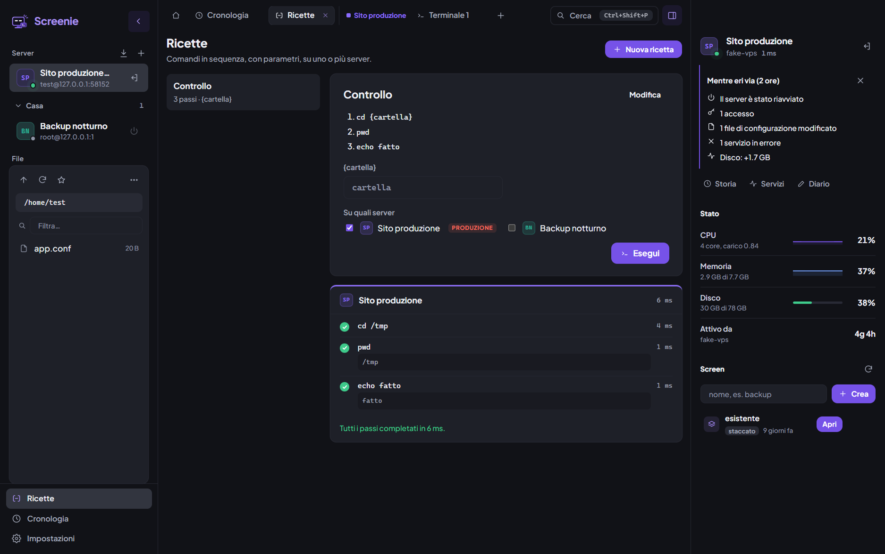
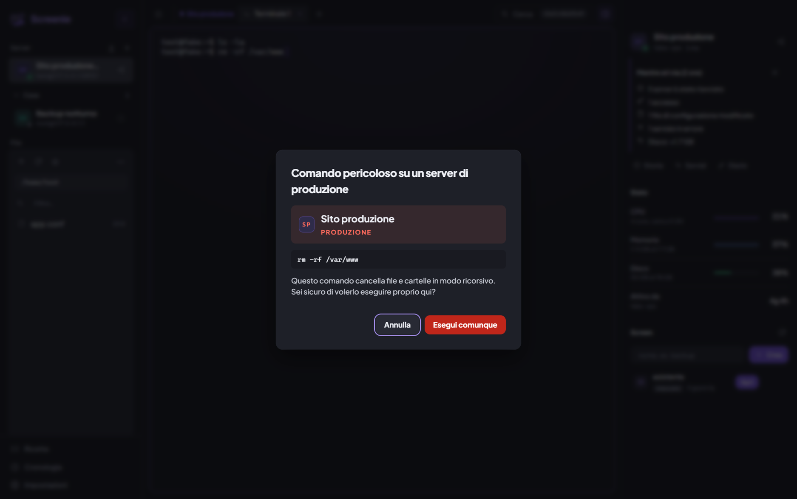

<div align="center">


# Screenie

**Il client SSH per chi gestisce i propri server.**<br>
Terminale, sessioni `screen`, file, editor e lo stato del server in un'unica finestra.

[](https://github.com/BisognaAvereFede/screenie/releases/latest)
[](https://github.com/BisognaAvereFede/screenie/releases)


[**Scarica Screenie**](https://github.com/BisognaAvereFede/screenie/releases/latest) ·
[Funzioni](#funzioni) ·
[Installazione](#installazione) ·
[Sicurezza](#sicurezza-e-privacy) ·
[Sviluppo](#sviluppo)

<br>



</div>

<br>

## Perché Screenie

Gestire un server da un terminale nudo significa ricordarsi tutto: quale server è quello di produzione, come si riavviava quel servizio, cosa è successo stanotte. Screenie tiene tutto questo per te.

- **Tutto in un posto**: terminali, sessioni `screen`, file via SFTP ed editor, senza aprire tre programmi diversi.
- **Sai sempre come sta il server**: CPU, memoria e disco in diretta, con la storia degli ultimi giorni.
- **Ti protegge dagli errori**: sui server di produzione i comandi pericolosi chiedono conferma.
- **Ricorda per te**: cronologia dei comandi, ricette riutilizzabili e un diario per ogni server.
- **Solo chiavi SSH**: niente password, e i segreti restano cifrati sul tuo PC.

## Funzioni

### Terminale e sessioni

- Terminali in schede **raggruppate per server**, divisibili fino a 4 riquadri (`Ctrl+Shift+E` / `Ctrl+Shift+O`).
- **Sessioni `screen`** create, agganciate, staccate e chiuse con un clic: quello che gira sul server continua anche se chiudi Screenie.
- Copia selezionando, incolla col tasto destro, ricerca nel terminale (`Ctrl+Shift+F`).
- **Scrivi in tutti i terminali** insieme (`Ctrl+Shift+A`).
- **Riconnessione automatica**: se la linea cade, Screenie si ricollega e riapre le sessioni.
- **Modalità focus** (`Ctrl+Shift+Invio`): resta solo il terminale.
- **Condividi in rete locale**: un link per far vedere un terminale in diretta nel browser di un collega sulla stessa rete, in sola lettura o con il permesso di scrivere.

### File ed editor

- Browser dei file via SFTP: trascina per caricare, tasto destro per scaricare, rinominare, eliminare.
- **Pubblica trascinando**: porta una cartella dal desktop sul server nella barra laterale, scegli dove copiarla e, se vuoi, Screenie ricarica nginx.
- **Editor integrato** con salvataggio automatico ed evidenziazione per decine di linguaggi.
- **Versioni e differenze**: le ultime 10 versioni di ogni file, e per i file di configurazione vedi le modifiche prima di salvarle.
- **Protezione dai conflitti**: se qualcun altro ha cambiato il file sul server, Screenie non lo sovrascrive.

### Stato del server



- **Macchina del tempo**: trascina sul grafico per tornare a un momento preciso e vedere quali processi consumavano CPU e memoria, con i log di quei minuti.
- **Mentre eri via**: quando ti ricolleghi vedi accessi, pacchetti aggiornati, file di `/etc` modificati, servizi in errore e riavvii.
- **Battito**: il pallino del server pulsa più veloce quando è sotto sforzo.
- **Traguardi di uptime** a 100 giorni, 6 mesi e 1 anno senza riavvii.



- **Mappa dei servizi**: cosa è raggiungibile da internet e cosa solo dall'interno, con il processo, le connessioni attive, i container Docker e i servizi systemd. Ogni voce ha il suo pulsante *Log*.

### Automazione e memoria



- **Ricette** (`Ctrl+Shift+R`): sequenze di comandi con parametri `{nome}`, eseguibili su più server insieme. Ogni passo mostra esito, tempo e output.
- **Cronologia comandi** (`Ctrl+Shift+H`): tutti i comandi dei terminali, con data e server, cercabili e trasformabili in ricetta.
- **Diario del server**: note in markdown; i comandi scritti dopo `$ ` o tra ``` diventano pulsanti *Esegui*.
- **Comandi salvati** e **palette** (`Ctrl+Shift+P`) per trovare qualsiasi server, scheda o azione.

### Sicurezza nell'uso quotidiano



- **Server di produzione**: `rm -rf`, `reboot`, `DROP TABLE`, `git push --force` e altri comandi rischiosi chiedono conferma, con il nome del server in grande.
- **Identità dei server**: ogni server ha un colore e una sigla, ripresi in barra laterale, schede e bordo del terminale, per non scrivere mai sul server sbagliato.

### Connessioni

- Importazione dei server da `~/.ssh/config`.
- **Jump host**, **tunnel locali** (`8080:localhost:80`), agent SSH di Windows, Pageant e agent forwarding.
- Gruppi, ricerca, latenza in diretta.
- All'avvio riapre i terminali, gli screen e i file dove li avevi lasciati.
- Backup ed esportazione della configurazione (senza passphrase).

## Installazione

### Windows

1. Scarica `Screenie-Setup-<versione>.exe` dalla [pagina delle versioni](https://github.com/BisognaAvereFede/screenie/releases/latest).
2. Aprilo: l'installazione è per il tuo utente e non chiede permessi di amministratore.
3. Al primo avvio Windows SmartScreen potrebbe avvisare che l'app non è firmata: clicca **Ulteriori informazioni → Esegui comunque**.

Gli **aggiornamenti sono automatici**: Screenie controlla all'avvio e ogni 4 ore, scarica la nuova versione in background e ti chiede solo di riavviare. Server e impostazioni restano.

### macOS

1. Scarica il file giusto per il tuo Mac (lo vedi in  → *Informazioni su questo Mac*):
   - `Screenie-<versione>-mac-arm64.dmg` per i chip Apple (M1, M2, M3, M4);
   - `Screenie-<versione>-mac-x64.dmg` per i Mac Intel.
2. Apri il `.dmg` e trascina Screenie in **Applicazioni**.
3. L'app non è firmata da Apple: al primo avvio vai in **Impostazioni di Sistema → Privacy e sicurezza** e clicca **Apri comunque**. Se macOS dice che l'app è danneggiata:

   ```bash
   xattr -cr /Applications/Screenie.app
   ```

Su Mac gli aggiornamenti per ora si scaricano a mano dalla stessa pagina.

### Primo avvio

La Home ti propone di aggiungere un server (host, utente, chiave privata) oppure di importare quelli che usi già con OpenSSH. Doppio clic sul server per connetterti.

## Scorciatoie

| Azione | Scorciatoia |
|---|---|
| Palette comandi | `Ctrl+Shift+P` |
| Nuovo terminale | `Ctrl+Shift+T` |
| Nuovo screen | `Ctrl+Shift+S` |
| Chiudi scheda | `Ctrl+Shift+W` |
| Scheda successiva / precedente | `Ctrl+Tab` / `Ctrl+Shift+Tab` |
| Cerca nel terminale | `Ctrl+Shift+F` |
| Dividi a destra / sotto | `Ctrl+Shift+E` / `Ctrl+Shift+O` |
| Scrivi in tutti i terminali | `Ctrl+Shift+A` |
| Ricette | `Ctrl+Shift+R` |
| Cronologia comandi | `Ctrl+Shift+H` |
| Modalità focus | `Ctrl+Shift+Invio` |
| Barra laterale / pannello server | `Ctrl+Shift+B` / `Ctrl+Shift+D` |
| Impostazioni | `Ctrl+,` |
| Elenco scorciatoie | `F1` |

Tutte modificabili in **Impostazioni → Scorciatoie**. Su Mac `Ctrl` diventa `⌘`.

## Sicurezza e privacy

- **Solo chiavi SSH**: file di chiave, agent SSH o Pageant, tramite la libreria [ssh2](https://github.com/mscdex/ssh2), diffusa e collaudata.
- **Impronta del server**: alla prima connessione ti mostra l'impronta della chiave del server; se cambia, la connessione si blocca con un avviso.
- **Passphrase cifrate**: salvate solo se lo chiedi, con la cifratura del sistema operativo (DPAPI su Windows, Portachiavi su macOS). La chiave privata non viene mai copiata.
- **Tutto resta sul tuo PC**: server, cronologia, metriche, diario e versioni dei file stanno nella cartella dell'app. Il backup esportato non contiene segreti.
- **Collegamenti esterni**: oltre ai tuoi server, Screenie contatta solo GitHub per controllare gli aggiornamenti. La condivisione del terminale è attiva solo quando la avvii, è limitata alla rete locale e il link smette di funzionare quando la interrompi.
- **Interfaccia isolata**: l'interfaccia non ha accesso diretto a file, rete o sistema; può solo chiedere le operazioni previste.
- **Eliminazioni protette**: cancellare `/`, la home o le cartelle di sistema di primo livello viene sempre rifiutato.

## Sviluppo

Serve [Node.js](https://nodejs.org) 22 o successivo.

```bash
git clone https://github.com/BisognaAvereFede/screenie.git
cd screenie
npm install
npm start
```

| Comando | Cosa fa |
|---|---|
| `npm start` | Compila l'interfaccia e avvia l'app |
| `npm run dist:win` | Crea l'installer Windows in `release/` |
| `npm run dist:mac` | Crea il `.dmg` (va lanciato su un Mac) |
| `npx electron test/backend.test.js` | Esegue i test contro un server SSH finto |

I test coprono connessione, passphrase, impronta del server, screen, SFTP (con un file da 30 MB), tunnel, jump host, macchina del tempo, ricette, mappa dei servizi, cronologia, versioni dei file e condivisione. Il server SSH finto è in `test/fake-server.js`.

### Struttura

```
electron/   processo principale: SSH, SFTP, dati locali, aggiornamenti, condivisione
src/        interfaccia (JavaScript senza framework, compilata con Vite)
test/       test del backend e server SSH finto
build/      icone dell'app
```

### Pubblicare una versione

```bash
npm version patch
git push --follow-tags
```

Il tag `vX.Y.Z` avvia GitHub Actions, che crea l'installer Windows e i `.dmg` per Mac e li pubblica in una Release. Le installazioni Windows esistenti si aggiornano da sole.

<div align="center">
<br>
<sub>Fatto con Electron, xterm.js, CodeMirror e ssh2.</sub>
</div>
